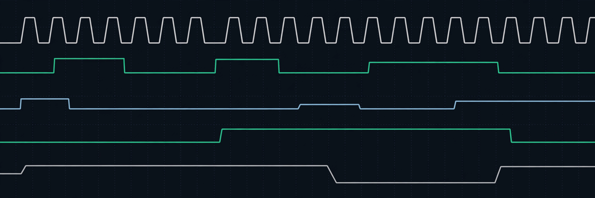
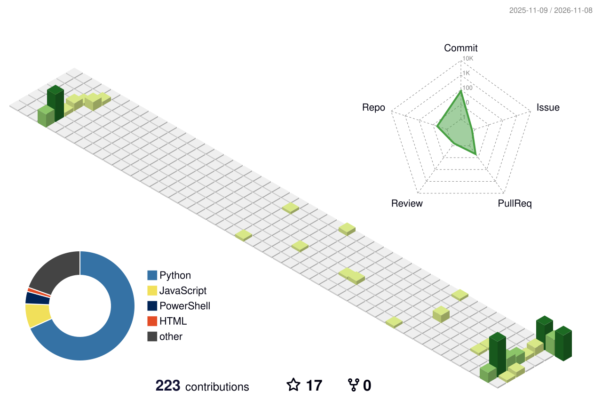

<!--
  Profile README for thanquannguyen — v4 (applied 2026-11-08).

  Render status — verified live 2026-11-08 by curl. EVERY widget below
  returned HTTP 200 with a real SVG/GIF body for username thanquannguyen:
  - Header: custom banner image assets/banner.png ("Logic Analyzer",
    1200x400, no text). Banner B (chip die) and C (aurora) are
    alternatives at the same path if swapped later.
  - ALIVE: terminal-typing-svg, icon-marquee, komarev views counter,
    github-profile-summary-cards (profile-details, stats,
    repos-per-language, most-commit-language, productive-time),
    github-readme-streak-stats, github-stats-extended pins,
    socialify Circuit Board cards, github-profile-trophy-rust
    (filtered titles only), capsule-render footer wave.
  - Generated daily: snake (.github/workflows/snake.yml),
    3D contribution (.github/workflows/profile-3d.yml),
    contribution FX (.github/workflows/contribution-fx.yml, branch
    `output`).
  Hard rules kept: no thesis topic in any form, no status section,
  no Vietnamese footer, generic academic tone, only verified facts.
-->

  
   
  

  <h1>Hi, I'm Nguyên </h1>

  

    <strong>Design Verification Engineer</strong> — 2 years of experience across UCIE, PMIC, 
    and now SoC for an electric-vehicle system.
  

  

    I'm also doing a master's at the University of Information Technology (VNU-HCM), 
    focusing on hardware verification, and I mentor a student team on their graduation project.
  

---

### 🛠 Tech Stack

  

**Verification**

---

### 🎯 Focus

- Constrained-random and coverage-driven verification
- Protocol verification and testbench architecture
- Open-source simulation flows (Cocotb + Verilator)
- Design verification for SoC, PMIC, and interconnect (UCIE)

---

### 📊 GitHub Stats

  

  
  

  

  
  

---

### 🐍 Contribution Snake

<!-- Generated daily by .github/workflows/snake.yml (Platane/snk).
     The SVGs appear in dist/ on main after the first workflow run;
     a 404 before that is expected. -->
<picture>
  <source media="(prefers-color-scheme: dark)" srcset="https://raw.githubusercontent.com/thanquannguyen/thanquannguyen/main/dist/github-contribution-grid-snake-dark.svg" />
  <source media="(prefers-color-scheme: light)" srcset="https://raw.githubusercontent.com/thanquannguyen/thanquannguyen/main/dist/github-contribution-grid-snake.svg" />
  
</picture>

---

### 🧊 3D Contribution

<!-- Generated daily by .github/workflows/profile-3d.yml
     (yoshi389111/github-profile-3d-contrib). SVG verified live on
     main 2026-11-08. -->

---

### ✨ Contribution FX

<!-- Generated by .github/workflows/contribution-fx.yml
     (Sur1ive/contribution-fx), published to the `output` branch. -->

### 🚀 Featured Projects

  
  

  
  

VNC Discord Bot — feature-rich Discord bot (moderation, leveling, automations) built with discord.js and MongoDB. *(Repo is private.)*

---

### 🏆 Trophies

  

---

